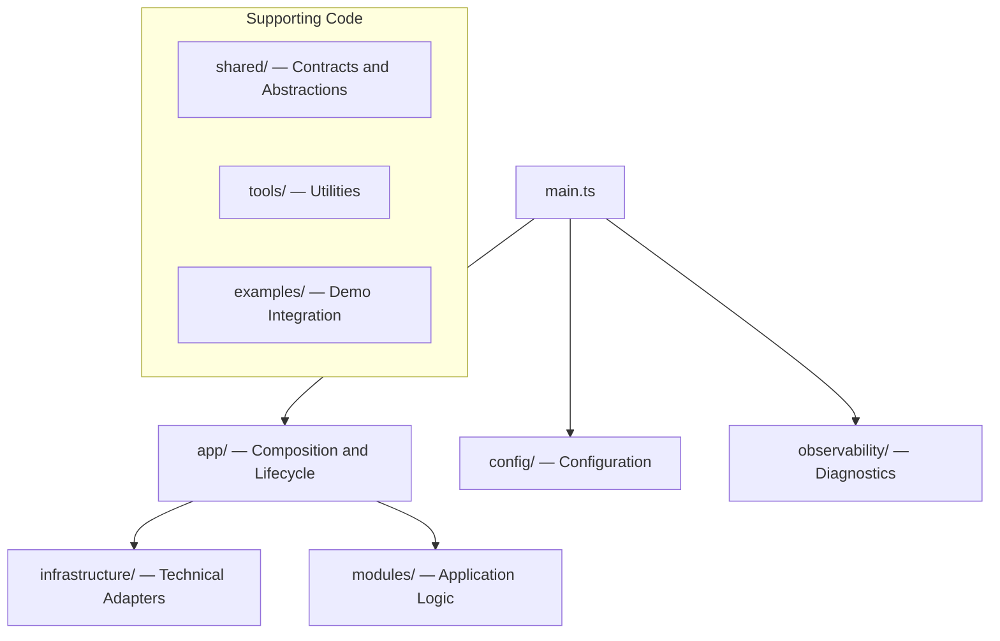
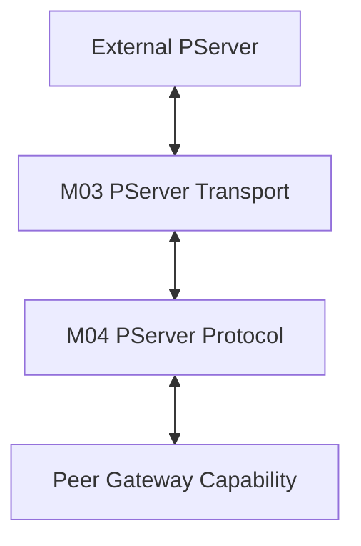
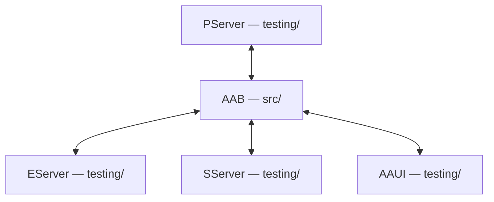

# AAB — Project Folder Structure

## 1. Document Context

- Repository: [base-aa-backend](https://github.com/vutuantrung/base-aa-backend)
- Branch: `main`
- Architecture baseline: `82b6cb68`
- Implementation checkpoint: `46ea64baee2a06df294665773adaaee76109c538`
- Current phase: R6.2.A completed; R6.2.B pending.
- Scope: Cấu trúc thư mục thực tế tại checkpoint trên và mapping với 18 architecture modules đã xác định tại R0–R5.

AAB hiện là Modular Monolith, kết hợp tổ chức theo technical layer và functional module. Các module boundaries không nhất thiết tương ứng một-một với thư mục vật lý.

## 2. Root Directory

```text
base-aa-backend/
├── src/                 # Application source code
├── tests/               # Backend automated tests
├── testing/             # Integration playground
├── docs/                # Documentation
├── scripts/             # Development & packaging tools
├── AGENTS.md            # AI coding instructions
├── README.md
├── package.json
├── package-lock.json
├── tsconfig.json
├── .gitignore
└── R6_*_REPORT.md       # Refactoring reports (grouped)
```

| Folder / File | Responsibility | Classification |
|---|---|---|
| `src/` | Application implementation | APP |
| `tests/` | Unit, integration và regression tests | TEST |
| `testing/` | Mô phỏng external systems và kiểm thử playground | DEMO / TEST |
| `docs/` | Tài liệu kỹ thuật, flows, API, architecture và future features | DOCS |
| `scripts/` | Công cụ phát triển và packaging; hiện có `package-for-arm.sh` | TOOLING |
| `AGENTS.md` | Quy tắc coding dành cho AI agents | GOVERNANCE |
| `package.json` | Dependencies, runtime requirements và commands | CONFIG |
| `package-lock.json` | Lock dependency versions | CONFIG |
| `tsconfig.json` | TypeScript compiler configuration | CONFIG |
| `R6_*_REPORT.md` | Báo cáo implementation và verification theo checkpoint | DOCS |

## 3. Application Source Tree

```text
src/
├── main.ts
├── app/
│   ├── create-app.ts
│   └── lifecycle.ts
├── config/
│   └── configuration.ts
├── infrastructure/
│   ├── database/
│   │   ├── persistence.ts
│   │   └── sqlite.ts
│   ├── http/
│   │   ├── http-server.ts
│   │   ├── http-outbound-adapter.ts
│   │   └── aa-catalog-router.ts
│   └── socket/
│       ├── socket-server.ts
│       ├── socket-outbound-adapter.ts
│       ├── peer-gateway.ts
│       ├── pserver-connector.ts
│       └── pserver-transport.ts
├── modules/
│   ├── aa-catalog/
│   │   ├── contracts.ts
│   │   └── sqlite-catalog.ts
│   ├── messaging/
│   │   ├── messaging.ts
│   │   ├── message-router.ts
│   │   └── route-registry.ts
│   ├── peer-messaging/
│   │   ├── contracts.ts
│   │   ├── peer-message-service.ts
│   │   ├── transformation-registry.ts
│   │   ├── task-file-store.ts
│   │   └── resource-selection-store.ts
│   ├── process-usage/
│   │   └── process-usage.ts
│   ├── pserver/
│   │   └── pserver-protocol.ts
│   └── session/
│       └── session.ts
├── observability/
│   └── diagnostics.ts
├── shared/
│   ├── contracts/
│   │   └── message.ts
│   └── transport/
│       ├── connectable-client.ts
│       └── message-bus.ts
├── examples/
│   └── pserver-to-aaui.ts
└── tools/
    └── utils.ts
```

### Logical overview



Sơ đồ thể hiện cách phân nhóm responsibilities, không phải đồ thị đầy đủ của source imports.

## 4. Application Foundation

Quản lý việc khởi tạo và vận hành application. Đây là nơi các dependencies và modules được kết nối với nhau.

### `src/main.ts` — Entrypoint

Tiếp nhận environment, gọi configuration resolution và application startup; quản lý OS signals `SIGINT`, `SIGTERM` và chuyển giao shutdown cho lifecycle functions.

### `src/app/` — Application Orchestration (M02)

| File | Responsibility |
|---|---|
| `create-app.ts` | Composition root: khởi tạo dependencies, repositories, servers, adapters và wiring giữa các modules. |
| `lifecycle.ts` | Startup và shutdown orchestration; đăng ký demo transformation khi được bật và ghi nhận lifecycle diagnostics. |

### `src/config/` — Configuration (M01)

Chuyển đổi environment variables thành typed application configuration.

`configuration.ts` chuyển environment input thành typed resolved configuration, quản lý defaults, validation, VM information và feature flags. Không khởi tạo runtime services. Automatic `.env` loading vẫn chưa được triển khai.

### `src/observability/` — Observability (M18)

Cung cấp khả năng quan sát và ghi nhận hoạt động của hệ thống.

`diagnostics.ts` cung cấp diagnostics interface và console implementation. Hiện chủ yếu phục vụ application lifecycle; communication và messaging diagnostics chưa được migrate toàn bộ.

## 5. Infrastructure — Technical Implementation

Chứa các technical adapters phụ thuộc vào Express, Socket.IO, SQLite và các công nghệ giao tiếp khác. Thư mục này chứa những implementation phụ thuộc vào công nghệ cụ thể như Express, Socket.IO và SQLite.

### `src/infrastructure/database/` — Persistence Infrastructure (M17)

| File | Responsibility |
|---|---|
| `persistence.ts` | Quản lý optional SQLite handle và resource lifecycle, bao gồm close. |
| `sqlite.ts` | Lazy-load SQLite driver, mở database, thiết lập pragmas và khởi tạo schema. |

Domain repositories vẫn thuộc các functional modules, không gom vào generic persistence repository. Standalone SQLite disabled mặc định; programmatic `createApplication()` vẫn enabled mặc định nếu không chỉ định khác.

### `src/infrastructure/http/` — HTTP Communication (M07, M08)

| File | Responsibility |
|---|---|
| `http-server.ts` | Express application, HTTP endpoints, authentication, validation và error handling. |
| `http-outbound-adapter.ts` | Gửi generic messages đến external HTTP webhook endpoints đã cấu hình. |
| `aa-catalog-router.ts` | HTTP endpoints của AA Catalog. |

### `src/infrastructure/socket/` — Socket Communication (M03, M05, M06 và integration wiring)

| File | Responsibility |
|---|---|
| `socket-server.ts` | Socket.IO server, namespace management, generic messaging ingress và broadcast. |
| `socket-outbound-adapter.ts` | Outbound generic messaging qua Socket.IO. |
| `peer-gateway.ts` | Peer identity, physical connection association, presence, delivery, task workflow, resource selection và snapshots. |
| `pserver-connector.ts` | Compatibility composition facade kết nối PServer transport và protocol. |
| `pserver-transport.ts` | Outbound Socket.IO client, connection lifecycle, reconnection, raw events và ACK timeout mechanism (M03). |

`peer-gateway.ts` là điểm tập trung responsibilities cần tiếp tục extract trong R6.2.B, R6.3 và R6.4.

## 6. Modules — Functional Application Logic

Đây là khu vực chứa các chức năng riêng biệt của application.

### `src/modules/messaging/` — Generic Messaging (M09)

Định tuyến message dựa trên channel và event.

| File | Responsibility |
|---|---|
| `messaging.ts` | `SendMessage` use case. |
| `message-router.ts` | Message dispatch, destination planning và outbound adapter selection. |
| `route-registry.ts` | Routing rules và destination resolution theo channel/event. |

GM nhận messages từ HTTP hoặc Socket.IO `/session`, `/worker`, sau đó gửi qua Socket hoặc HTTP outbound adapters.

### `src/modules/peer-messaging/` — Peer Messaging & Workflows (M10–M13)

Xử lý message giữa các peer, transformation và workflow persistence.

| File | Responsibility |
|---|---|
| `contracts.ts` | Peer message types và validation schemas. |
| `peer-message-service.ts` | Peer message processing và delivery coordination. |
| `transformation-registry.ts` | Message transformation rules (M11). |
| `task-file-store.ts` | Task và task result JSON persistence (M12). |
| `resource-selection-store.ts` | Resource selection JSON persistence (M13). |

PM sử dụng peer ID và instance ID để xác định destination. Một phần orchestration của M10, M12 và M13 vẫn nằm trong `peer-gateway.ts`. GM và PM là hai messaging systems riêng biệt, không dùng chung một MessageRouter.

### `src/modules/pserver/` — PServer Protocol (M04)

Session registration, resumption, readiness và protocol validation.

`pserver-protocol.ts` quản lý session registration, resumption, session ID, session readiness, protocol events, task dispatch validation và peer-message ACK behavior. Sử dụng transport capability thay vì import trực tiếp Socket.IO client. Được extract tại R6.2.A.



### Data Modules (M14–M16)

| Folder | Files | Responsibility |
|---|---|---|
| `modules/session/` | `session.ts` | Generic session records và repository (M14), khác với PServer protocol session. |
| `modules/process-usage/` | `process-usage.ts` | Lưu trữ và truy vấn CPU, memory usage theo process (M15). |
| `modules/aa-catalog/` | `contracts.ts`, `sqlite-catalog.ts` | Dữ liệu connections, browsers, extensions, activities và tasks (M16). |

Các tính năng phụ thuộc SQLite bị disable mặc định trong standalone mode, nhưng vẫn là các architecture responsibilities.

## 7. Shared & Supporting Code

| Folder / File | Responsibility |
|---|---|
| `shared/contracts/message.ts` | Shared generic-message contracts. |
| `shared/transport/connectable-client.ts` | Shared communication abstraction. |
| `shared/transport/message-bus.ts` | Shared message-bus abstraction. |
| `examples/pserver-to-aaui.ts` | Demo transformation và example integration. |
| `tools/utils.ts` | File utility dự kiến; hiện rỗng theo baseline đã review. |

Cần kiểm soát `shared/` và `tools/` để không trở thành nơi chứa responsibilities chưa được phân loại.

## 8. Testing Environment

| Folder | Purpose | Tests tại R6.2.A |
|---|---|---:|
| `tests/` | Backend automated verification: unit, integration, regression và protocol tests. | 51 |
| `testing/` | Integration playground: mock servers, Electron UI và simulated workflows. | 32 |

### `tests/`

Bao gồm tests cho configuration, routing/forwarding, PServer sessions/protocol, peer connections, presence, multi-EServer, task receipt/result, resource selection, AA Catalog và persisted snapshots. `tests/support/mock-pserver.ts` cung cấp mock PServer cho automated integration tests.

### `testing/`

```text
testing/
├── README.md
├── package.json
├── pserver.mjs
├── eserver.mjs
├── sserver.mjs
├── aaui/
│   ├── package.json
│   ├── main.cjs
│   ├── preload.cjs
│   ├── renderer.js
│   ├── dashboard-state.js
│   ├── index.html
│   ├── styles.css
│   └── tests/
├── shared/
│   ├── create-peer-server.mjs
│   ├── mock-vm-info.mjs
│   ├── scheduled-peer-message.mjs
│   ├── resource-selection.cjs
│   └── task-flow.cjs
└── tests/
```

| Component | Purpose |
|---|---|
| `pserver.mjs` | Mock PServer và session protocol. |
| `eserver.mjs` | Mock EServer, multiple instances và scheduled VM information. |
| `sserver.mjs` | Mock SServer và scheduled status messages. |
| `aaui/` | Electron dashboard mô phỏng user interface và lifecycle monitoring. |
| `shared/` | Helpers dùng chung trong playground. |
| `tests/`, `aaui/tests/` | Automated tests dành cho playground. |



Verification commands (Node.js 22, theo baseline R6.2.A):

```bash
npm run typecheck
npm run build
npm test -- --test-concurrency=1
npm --prefix testing run test:playground
```

Theo báo cáo R6.2.A, cả hai suites pass 83/83 tests. Đây là kết quả đã báo cáo, không phải một lần chạy mới khi tạo tài liệu này.

## 9. Architecture Module Mapping

| ID | Module | Current location / responsibility concentration | Extraction status |
|---|---|---|---|
| M01 | Configuration | `src/config/` | Completed |
| M02 | Application Lifecycle | `src/app/` | Completed |
| M03 | PServer Transport | `src/infrastructure/socket/pserver-transport.ts` | Completed |
| M04 | PServer Protocol | `src/modules/pserver/` | Completed |
| M05 | Socket Gateway | `src/infrastructure/socket/` | R6.2.B pending |
| M06 | Peer Directory | `peer-gateway.ts` | R6.2.B pending |
| M07 | HTTP Gateway | `src/infrastructure/http/` | R6.2.C pending |
| M08 | Integration Clients | Infrastructure communication adapters | R6.2.C pending |
| M09 | Generic Messaging | `src/modules/messaging/` | R6.3 pending |
| M10 | Peer Messaging | `src/modules/peer-messaging/`, `peer-gateway.ts` | R6.3 pending |
| M11 | Transformation | `transformation-registry.ts` | R6.3 pending |
| M12 | Task Workflow | `task-file-store.ts`, `peer-gateway.ts` | R6.4 pending |
| M13 | Resource Selection | `resource-selection-store.ts`, `peer-gateway.ts` | R6.4 pending |
| M14 | Generic Session | `src/modules/session/`, HTTP integration | R6.4 pending |
| M15 | Process Usage | `src/modules/process-usage/`, HTTP integration | R6.4 pending |
| M16 | AA Catalog | `src/modules/aa-catalog/`, HTTP integration | R6.4 pending |
| M17 | Persistence Infrastructure | `src/infrastructure/database/` | Completed |
| M18 | Observability | `src/observability/` | Completed (initial boundary) |

**Progress: 6/18 boundaries extracted (33.3%).** Pending không có nghĩa là chức năng chưa tồn tại; nghĩa là chưa hoàn thành boundary extraction theo roadmap.

| Checkpoint | Scope | Status |
|---|---|---|
| R6.0 | Baseline verification | Completed |
| R6.1 | M01, M02, M17, M18 | Completed |
| R6.2.A | M03, M04 | Completed |
| R6.2.B | M05, M06 | Next |
| R6.2.C | M07, M08 | Pending |
| R6.3 | M09–M11 | Pending |
| R6.4 | M12–M16 | Pending |

## 10. Mental Model — Tìm code ở đâu?

| Question | Folder |
|---|---|
| Application khởi động và đóng như thế nào? | `main.ts`, `app/` |
| Application được cấu hình như thế nào? | `config/` |
| Application giao tiếp và truy cập storage bằng cách nào? | `infrastructure/` |
| Application thực hiện chức năng gì? | `modules/` |
| Contracts nào dùng chung? | `shared/` |
| Làm sao quan sát application? | `observability/` |
| Làm sao xác minh application hoạt động đúng? | `tests/` |
| Làm sao mô phỏng các external systems? | `testing/` |
| Tài liệu và thiết kế nằm ở đâu? | `docs/` |

## 11. Architecture Notes

- Chưa cần tổ chức lại toàn bộ folder tree hoặc chuyển sang microservices.
- Tiếp tục Breadth-first Architectural Decomposition, extract theo từng responsibility boundary.
- R6.2.B chỉ tách Socket Gateway và Peer Directory; không extract business workflows sớm.
- Chuẩn hóa folder structure và dependency direction sẽ tiếp tục tại R7–R8.
- Tài liệu này mô tả trạng thái As-Is tại R6.2.A, không phải target folder structure sau khi hoàn thành refactor.

## Source & Limitations

- [GitHub source tree — checkpoint 46ea64ba](https://github.com/vutuantrung/base-aa-backend/tree/46ea64baee2a06df294665773adaaee76109c538)
- [R6.2.A implementation report](https://github.com/vutuantrung/base-aa-backend/blob/46ea64baee2a06df294665773adaaee76109c538/R6_2_A_PSERVER_COMMUNICATION_REPORT.md)

Tổng hợp từ cây thư mục đã kiểm tra trên GitHub và phân tích architecture trước đó. Generated folders, local/untracked files và runtime data không nằm trong scope. Không thay đổi repository hoặc chạy lại tests khi tạo tài liệu.
