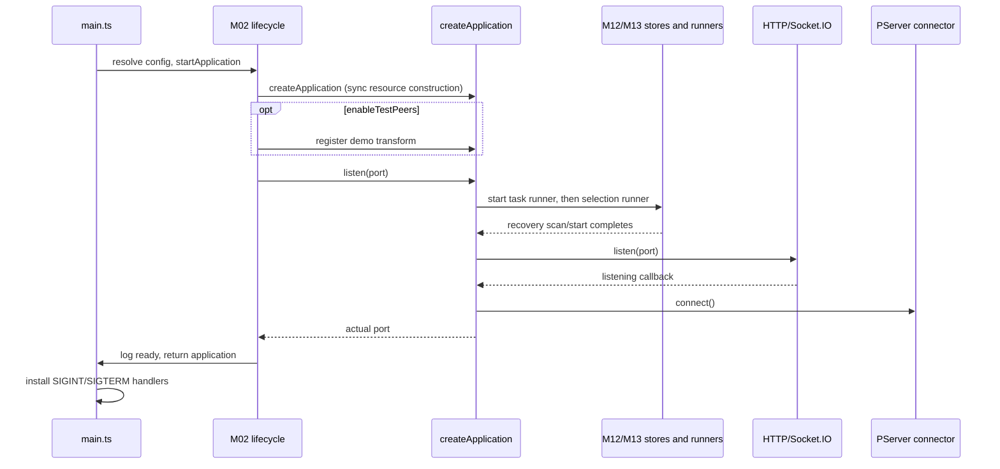

# R7.6 Lifecycle Decision Baseline

## Checkpoint and evidence

- Repository `vutuantrung/base-aa-backend`, branch `main`, committed source baseline `9c3cb2bec19dcc2cf9d31ce505bd84dc7a90a539`.
- R7.5.C was reviewer-accepted for scoped Linux process-crash reliability. Its committed report and harness are evidence for process termination on Linux `/tmp` (`tmpfs`), not power loss or deployed filesystems: [C report](../../R7_5_C_FAILURE_RESTART_VERIFICATION_REPORT.md), [crash tests](../../tests/reliable-crash-process.test.ts).
- This checkpoint adds no production behavior. Application listener tests could not execute because local loopback returned `listen EPERM`, including after approval attempt; application lifecycle outcomes below are source review unless labeled otherwise.
- Source checked on Node `v22.23.5`; Node 24 native SQLite behavior is outside this checkpoint.

## Ownership inventory

| Resource | Owner / construction | Readiness, admission, active work | Close and evidence |
|---|---|---|---|
| App lifecycle and HTTP listener | M02 `createApplication` constructs persistence, Express/HTTP, Socket.IO and optional PServer connector; `startApplication` applies demo transform, calls `listen` | `listen` starts M05 peer gateway before `httpServer.listen`; PServer `connect()` is called only in successful listen callback. No shared listen promise/state. | M02 closes PServer, peer gateway, Socket.IO, HTTP if listening, then SQLite. Sequential fail-fast chain; first rejection skips later cleanup. Listener integration is source-inferred. |
| Signals / process exit | `main.ts` owns SIGINT/SIGTERM handlers | Installed only after startup resolves. First signal calls stop; repeats are ignored while stopping. | Entrypoint calls `process.exit(0/1)` after `close`; startup failure occurs before handlers. No deadline or second-signal escalation. |
| Socket.IO / Engine.IO | M05 `createSocketGateway` constructs server and namespaces on HTTP server | Auth middleware is admission for peer namespaces. Existing sockets can continue emitting until closed. Generic socket messages await M09 sender, then ACK success/failure; no active-request registry. | `io.close` callback is awaited. Exact active/hung request interactions are not separately controlled in tests here. |
| Peer identity / M04 session | M05 owns socket connection maps; M06 logical identities; M03 transport and M04 protocol composed by connector | M04 `connected` means transport connected **and** session registration accepted. It is independent of HTTP `/health`, individual EServer readiness, and JSON store availability. M04 ACK-gated ingress returns `UNSUPPORTED_DESTINATION` before session-ready; absent ACK callback is not processed. | PServer connector `close()` invalidates generation and disconnects transport synchronously. Inbound callback already awaiting gateway has no cancellation. Session resume and stale-generation behavior remain R7.2 evidence, not drain proof. |
| Durable task and selection workflows | M12/M13 own workflow, record stores, runner; M05 composes each with M10 and snapshots | Authenticated peer `peer:message` awaits transformation/receipt commit/projection/enqueue before ACK. Duplicate may prepare concurrently; receipt dedupe is guaranteed, transformer side effects are not. M13 snapshots read recent store state; AAUI reconnect triggers detached snapshot work. | Runner close clears pending and timer; returns boolean for startup/executing activity. M05 uses it to preserve writer lock. It does not await work. Disk store owns `.writer.lock`, temp/canonical/quarantine evidence. |
| Runner timers / global attempt slots | Shared `ReliableOutboxRunner` code; per-workflow runner + store; process-wide FIFO limiter | Startup recovery scan, periodic scan, readiness wake, enqueue, per-runner pending/active/executing sets. A task enters `executing` before awaiting global slot; close clears pending/timer, but slot waiters remain and are not canceled. Active attempt can be between get, attempting write, emit, outcome write and callback. | `close()` is synchronous boolean, not quiescence. Existing test proves active close preserves lock and restart marks attempting uncertain; global slot waiter/late callback behavior is source-derived, not characterized. |
| Generic M09 fan-out | M02 constructs router and HTTP/Socket outbound adapters; M09 plans then `Promise.all` delivers | HTTP/Socket ingress and direct `sender.execute` call the same router; no lifecycle admission gate or in-flight tracking. One branch may finish while another hangs/fails. | M02 transport close can overlap this work; current R7.5 D05 preserves partial outcomes. |
| HTTP requests / outbound HTTP | M07 Express app on M02 HTTP server; M09 HTTP adapter | `/health` returns `{status:"ok"}` independent of peer/session/store state. `/api` authentication runs before disabled-SQLite capability mapping. Outbound webhook uses 5s fetch timeout; external clients and direct sender callers have no app gate. | `httpServer.close` waits according to Node server semantics for accepted connections; keepalive/hung inbound request interactions were not exercised due listener restriction. Outbound `fetch` is bounded per adapter; no app cancellation. |
| SQLite / JSON persistence | M17 app DB handle; M12/M13 separate JSON store instances/directories | SQLite opens synchronously during app construction if enabled; startup errors can happen before a handle is returned. Durable intake commits receipt before positive ACK. | DB close is synchronous, after socket closes. Store close waits for initialization and releases/preserves writer ownership, but application cannot see in-flight ingress as a set. Optional SQLite-disabled routes retain existing response matrix. |
| Transformations, notifications, snapshots | M11 transforms in M10 service; M12/M13 notify through M05 callbacks; M05 snapshots | Transform can be awaiting during close; commit, sync notification and enqueue follow it. Notifications are synchronous emit calls, not ACKed. Snapshots on connection/refresh are detached promises and have no tracked cancellation. | No global operation tracking or snapshot join. Side effects and late callbacks are inferred from source; no lifecycle characterization test currently proves settlement ordering. |
| Integration clients | M08 owns reusable HTTP/Socket clients | Consumer-created clients track their own sockets; no app-level owner or registration. | Their own `close()` exists; app lifecycle does not own arbitrary consumers. |

`enableTestPeers` adds M05 peer gateway, M12/M13 stores/runners and optional M03/M04 connector only when PServer config is present. `enableSqlite` controls M17 and route capability; it does not control M05 readiness. Config construction, webhook validation, SQLite open, Socket.IO construction and connector UDID validation can throw before `listen`. `startApplication` currently has no general rollback around a post-construction startup failure.

## Current sequences

### Startup



Evidence: `create-app.ts`, `lifecycle.ts`, `main.ts`, `peer-gateway.ts`. Runner recovery completes before bind; `/health` becomes reachable before M04 PServer session registration can complete. `listen` error has a one-shot listener but no rollback of already-started peer runners; `startApplication` does not close after it rejects. Concurrent/repeated listen behavior is not an explicit API contract. The local characterization test could not run because binding returned `EPERM`.

### Shutdown

```mermaid
sequenceDiagram
  participant Signal as main.ts
  participant L as stopApplication
  participant App as M02 close
  participant P as PServer connector
  participant Store as M12/M13 runners and stores
  participant Socket as Socket.IO
  participant HTTP as HTTP server
  participant DB as M17 SQLite
  Signal->>L: first SIGINT/SIGTERM
  L->>App: close()
  App->>P: close transport (sync)
  App->>Store: runner close, then store close sequentially in peerGateway
  Store-->>App: release lock or preserve if startup/executing
  App->>Socket: io.close()
  Socket-->>App: close callback
  App->>HTTP: close if listening
  HTTP-->>App: callback/error
  App->>DB: persistence.close()
  App-->>L: resolve/reject
  L-->>Signal: outcome; process.exit(0/1)
```

The sequence is source-derived, not a promise that dependencies are quiescent. Runner close does not await; M04 transport is closed before peer workflows; Socket.IO/HTTP closure follows outbox storage close. Any earlier rejection skips later steps. No total deadline exists, and process exit is explicit at entrypoint after close settles.

## Readiness and failure matrix

| Signal/failure | Current meaning/effect | Evidence status |
|---|---|---|
| `/health` 200 | HTTP app route responds; no readiness aggregation | Direct source |
| M04 `connected` | PServer physical socket plus successful session ACK; generation fences stale resume result | Source + existing M04 tests; remote server unverified |
| EServer destination ready | Exact logical instance has connected socket; workflow delivery target-specific | Source + M10/M12 tests |
| JSON state lock/capacity/publication failure | Durable ingress can return current `DELIVERY_FAILED`; does not make process health false | Source + committed C tests |
| SQLite disabled | Existing route-specific statuses/bodies remain; auth runs first on `/api` | R7.3 baseline and current source |
| Peer offline / retry due later | Durable receipt may be accepted; work remains queued/retryable | R7.5 policy/tests; not process readiness |
| Runner startup failure | `peerGateway.start` attempts own cleanup; M02 does not close other app resources if it rejects | Direct source; partial runner test exists, app rollback unverified |
| HTTP bind failure after runner startup | `listen` rejects; runners remain started until explicit close | Direct source; app test blocked by listener permission |
| PServer connect/session failure | Listener remains bound; physical/retry readiness differs from local HTTP | Source + M04 tests; failure timing remote unverified |
| Close with ingress, generic fan-out, snapshot, ACK or attempt pending | No universal admission cutoff; some work may finish after close starts; active delivery may retain lock | Source + runner active-close test; most app interleavings unverified |

Preserve `/health` status/body, auth-first behavior, disabled-SQLite route matrix, ACK-gated peer ingress and current error codes until owner decisions approve compatible behavior. Do not equate offline peer, full queue, disabled optional dependency or draining process with dead process. Readiness gate behavior for new connections versus established sockets/direct internal callers remains pending.

## Proposed dependency-aware shutdown order (pending)

Recommendation for D03/D05: mark lifecycle draining and stop new app-owned admission and scheduler launches; stop listener/connection admission while retaining required existing transport ability; allow already-admitted receipt preparation/commit/ACK path and already-started durable attempt/outcome commit to settle within a single deadline; keep M03/M05 transports and M12/M13 stores available until their known work settles; then close peer transport/socket and HTTP layers, then M17 persistence. Preserve queued/retryable future work. No additional send attempt begins during drain. M09 fan-out, snapshots and arbitrary direct sender calls need explicit inclusion/cutoff decisions because there is no central registry today.

Dependency order must avoid closing M04/M05 transport needed by accepted delivery, and avoid waiting for an ACK after shutting down the peer whose ACK is required. If work cannot be safely stopped or a store may still mutate, retain writer lock and evidence; timeout is not proof of cancellation. The exact ordering, admission gate and deadline are pending D01–D06 owner review.

## Characterization performed in R7.6.A

- `node --import tsx --test tests/reliable-outbox.test.ts` on Node 22.23.5: PASS (file-level runner reported success; existing cases include startup/close race, active close lock preservation, scans and limiter bounds).
- `npm run check:architecture`: PASS, 55 files / 131 resolved edges; zero runtime file SCCs; existing module SCC remains.
- `npm run typecheck`: PASS. `npm run build`: PASS.
- Application listener characterization was attempted; sandbox returned `listen EPERM` for both wildcard and loopback binds. A narrow escalated attempt was granted, but nested command execution remained sandboxed and still returned EPERM. No app listener case is claimed reproduced. No full backend or playground suite was run in this docs/characterization checkpoint.
- Source-only outcomes: repeated `close()` before listen is guarded only indirectly by idempotent M12/M13 store close; `listen()` after close attempts startup on closed runner/store and then server listen; concurrent listen calls are not serialized; bind failure leaves runner started; close ordering is sequential fail-fast. Confirmable app-level outcomes remain a R7.6.B verification item.

## R7.5 residual risk carried forward

Committed C report: C03 concurrent same-key preparation/transform may execute twice before receipt create serialization; transformers must be side-effect-free or idempotent for safe use. Process-wide attempts are capped at 4. M12/M13 quotas are fixed at 5,000 records / 128 MiB each (aggregate 10,000 / 256 MiB). There is no automatic GC. Stale lock recovery fails closed and requires verified owner-dead procedure. Receiver dedupe, production filesystem behavior, remote business completion, and power-loss behavior are unverified; no exactly-once or unconditional at-least-once claim.
