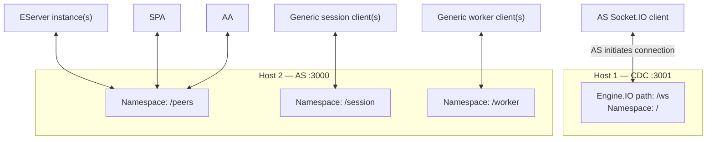
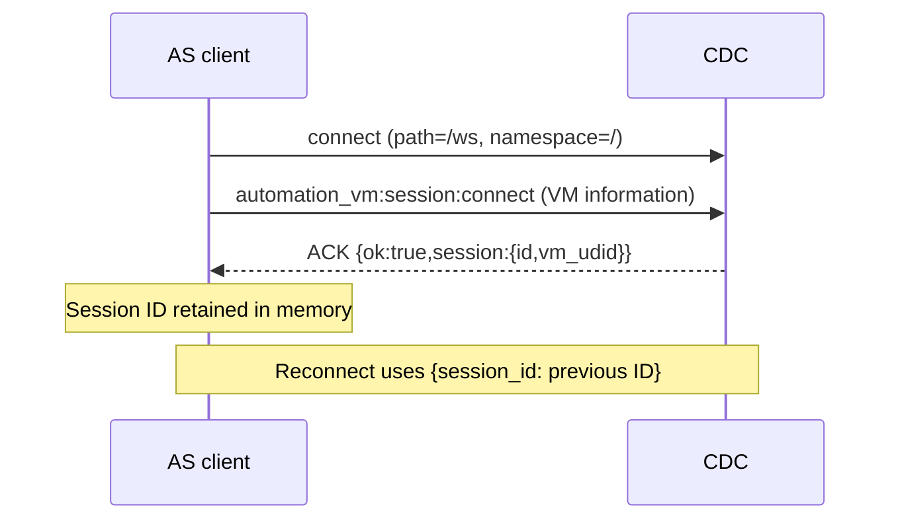

# AS — Socket.IO Hosts, Namespaces & Events Inventory

**Status:** Development baseline / source inventory  
**Repository:** [`vutuantrung/base-aa-backend`](https://github.com/vutuantrung/base-aa-backend)  
**Branch:** `main`  
**Source checkpoint:** `72b31e54e266743fbfd18b6169e4a85c843ddeb7` (R7.10 closure)  
**Purpose:** Reference inventory for integrating peers, documenting protocol ownership, and assessing future feature impact. This document is not evidence of production deployment or live connections.

> **Scope.** Two *primary integration Socket.IO hosts* are considered: CDC and AS. EServer/SPA playground processes also create local diagnostic Socket.IO servers, but those are not part of the two-host integration topology. `path`, `namespace`, Socket.IO `event`, and `payload.type` are separate concepts.

## 1. Integration topology



| Host | Local development URL | Engine.IO path | Namespace | Connection initiator / consumer |
|---|---|---|---|---|
| CDC | `http://127.0.0.1:3001` | `/ws` | `/` | AS initiates an outbound client connection |
| AS | `http://127.0.0.1:3000` | `/socket.io` (Socket.IO default) | `/peers` | EServer, SPA, AA connect inbound; enabled by peer feature gate |
| AS | `http://127.0.0.1:3000` | `/socket.io` | `/session` | Generic session clients |
| AS | `http://127.0.0.1:3000` | `/socket.io` | `/worker` | Generic worker clients |

**Important:** The network connection initiator does *not* determine business message direction. The AS ↔ CDC socket is bidirectional although AS initiates it. The CDC Engine.IO path `/ws` is **not** a namespace.

## 2. Host 1 — CDC (`/ws`, namespace `/`)

The **CDC playground** accepts AS as a Socket.IO client. `src/modules/cdc/cdc-protocol.ts` is the AS-side protocol implementation; `testing/cdc.mjs` is the test-host implementation.

| Event | Sender → receiver | Handler / emitting implementation | Function | ACK / status |
|---|---|---|---|---|
| `automation_vm:session:connect` | AS → CDC | AS protocol emits; test CDC handles | Initial VM registration or session resume | Required ACK; registration timeout 10,000 ms |
| `activity:task:dispatch` | CDC → AS | Test CDC emits; AS protocol handles | Incoming activity task notification | AS validates session/VM and logs; no automatic workflow forwarding |
| `peer:message` | CDC ↔ AS | Both ends handle/emit | Business peer envelope, including F08/F09/M13 and generic forwarding | Peer-level ACK; AS outbound timeout 5,000 ms |
| `peer:ping` | AS → CDC **handler available in playground** | Test CDC handles | Diagnostic ping | Optional `{ok:true,from:'cdc',timestamp}` ACK |
| `cdc:welcome` | CDC → AS | Test CDC emits | Playground connection greeting | No AS application-level handler confirmed |

### 2.1 Registration handshake



**Initial registration payload** (example):

```json
{
  "udid": "vm-001",
  "sdk": "33",
  "model": "Pixel",
  "abi": "arm64-v8a",
  "forSearch": false,
  "platforms": ["facebook"]
}
```

**Successful ACK** (example):

```json
{
  "ok": true,
  "session": {
    "id": "session-001",
    "vm_udid": "vm-001"
  }
}
```

On reconnect AS sends `{ "session_id": "session-001" }`. The session ID is not persisted across AS process restart. Session readiness is separate from raw transport connectivity.

### 2.2 Business types carried by CDC `peer:message`

| `payload.type` | Direction | Role |
|---|---|---|
| `demo.task.request` | CDC → AS → EServer | F08: task request receipt, outbox and downstream delivery |
| `demo.task.result` | EServer → AS → CDC | F09: finished task result |
| `demo.resource-selection` | AA → AS → CDC | M13 resource selection |
| `demo.reply` | AA → AS → CDC | Playground example, not a separate durable workflow |
| Other valid peer types | To/from CDC where routing supports | Generic peer messaging; not automatically a named business workflow |

`activity:task:dispatch` is **not** the same operation as `demo.task.request`. The former currently validates/logs only.

## 3. Host 2 — AS (`/socket.io`)

### 3.1 Namespace `/peers`

Peer admission expects Socket.IO `handshake.auth.peerId` of `eserver`, `spa`, or `aa`, optional `instanceId`, and optional `token` when `API_KEY` is configured. CDC does **not** connect to this namespace: AS connects outward to CDC.

| Event | Sender → receiver | Purpose | ACK / notes |
|---|---|---|---|
| `as:welcome` | AS → connected peer | Confirm connection and identify peer | Event with `{from,to,instanceId,message,timestamp}` |
| `peer:ping` | Peer → AS | Diagnostic ping | Optional ACK `{ok:true,from:'as',timestamp}` |
| `peer:message` | Peer ↔ AS | Validated addressed peer message | Ingress expects acknowledgment callback; destination delivery uses a 5-second ACK timeout |
| `peer:status` | AS → AA | EServer online/offline transitions | Presence, not VM/status telemetry |
| `peer:status:snapshot` | AS → AA | Snapshot of connected EServer instances | Sent on AA connection/reconnection |
| `task:lifecycle` | AS → AA | F08 request receipt/delivery state | `received`, `forwarded`, `forwardFailed` |
| `task:result:lifecycle` | AS → AA | F09 result receipt/delivery state | `received`, `forwarded`, `forwardFailed` |
| `task:lifecycle:snapshot` | AS → AA | Task history snapshot | Up to 50 records; emitted on connection and refresh |
| `task:lifecycle:refresh` | AA → AS | Request a fresh task snapshot | No application-level ACK defined |
| `resource-selection:updated` | AS → AA | Selection receipt / delivery update | `pending`, `forwarded`, `forwardFailed` projection |
| `resource-selection:snapshot` | AS → AA | Recent selection history | Up to 50 records; emitted on connection and refresh |
| `resource-selection:refresh` | AA → AS | Request a fresh selection snapshot | No application-level ACK defined |

**Count: 12 distinct application-level event names** on `/peers`. Sending an event in both directions does not increase the event-name count.

#### Peer envelope (`peer:message`)

Example of a valid inbound request:

```json
{
  "version": "1.0",
  "kind": "request",
  "from": "cdc",
  "to": "eserver",
  "toInstanceId": "e-1",
  "channel": "worker",
  "event": "message",
  "correlationId": "request-001",
  "payload": {
    "type": "demo.task.request",
    "version": "1.0",
    "data": {
      "id": "task-demo-001",
      "status": "inProgress",
      "config": "automation configuration",
      "createdTime": 1794500000000,
      "updatedTime": 1794500000000
    }
  }
}
```

- `kind` is `request`, `response`, or `event`.
- `from` must match the authenticated connection. For inbound `/peers`, accepted identities are EServer, SPA, and AA; the CDC example above is sent on the **CDC host connection**, not `/peers`.
- `to` supports `as`, `cdc`, `eserver`, `spa`, `aa` subject to destination rules.
- `toInstanceId` is supported for EServer only; omitted EServer target requires an unambiguous instance.
- `payload.type` is a business discriminator *inside* the single `peer:message` Socket.IO event; it is not itself a Socket.IO event name.
- AS can assign `id` and `timestamp` and add `processing` and authenticated `sourceInstanceId` metadata to forwarded envelopes.

**General peer ACK success** (representative):

```json
{ "ok": true, "data": { "id": "<generated-uuid>", "version": "1.0", "kind": "event", "from": "eserver", "to": "aa", "channel": "worker", "event": "message", "timestamp": 1794500000000, "payload": { "type": "eserver.vm-info", "version": "1.0", "data": [] }, "processing": { "transformed": false, "processedBy": [], "timestamp": 1794500000000 } } }
```

**Error ACK** (example):

```json
{ "ok": false, "code": "DESTINATION_OFFLINE", "error": "Destination aa is offline" }
```

The `PeerMessageAck` error-code union includes: `INVALID_MESSAGE`, `SENDER_MISMATCH`, `DESTINATION_OFFLINE`, `TRANSFORMATION_FAILED`, `DELIVERY_FAILED`, `UNSUPPORTED_DESTINATION`, `AMBIGUOUS_DESTINATION`.

**F08/F09/M13 receipt ACK** (different semantics):

```json
{
  "ok": true,
  "status": "received",
  "data": { "id": "<generated-uuid>", "version": "1.0", "kind": "request", "from": "cdc", "to": "eserver", "channel": "worker", "event": "message", "timestamp": 1794500000000, "payload": { "type": "demo.task.request", "version": "1.0", "data": { "id": "task-demo-001", "status": "inProgress", "config": "automation configuration", "createdTime": 1794500000000, "updatedTime": 1794500000000 } } }
}
```

The `received` ACK confirms canonical receipt and delivery-intent commit under R7.5 policy, **not** successful delivery to EServer/CDC, remote persistence or business completion.

#### `payload.type` examples used in playground/workflows

| `payload.type` | Sender → target | Scope |
|---|---|---|
| `demo.task.request` | CDC → EServer | Durable F08 workflow |
| `demo.task.result` | EServer → CDC | Durable F09 workflow |
| `demo.resource-selection` | AA → CDC | Durable M13 workflow |
| `eserver.scheduled-update` | EServer → AA | Playground scheduled mock status, every 10 seconds |
| `eserver.vm-info` | EServer → AA | Playground mock VM inventory, every 20 seconds |
| `demo.reply` | AA → CDC | Playground reverse-direction example |
| `demo.enrich` | Configured sender → target | Transformation example, not a required default business operation |

### 3.2 Namespace `/session`

| Event | Direction | Format |
|---|---|---|
| `message` | Client → AS | `{event, payload, correlationId?}` |
| `message` | AS → namespace clients | `{id,channel,event,payload,timestamp,correlationId?,origin?}` |

### 3.3 Namespace `/worker`

| Event | Direction | Format |
|---|---|---|
| `message` | Client → AS | `{event, payload, correlationId?}` |
| `message` | AS → namespace clients | `{id,channel,event,payload,timestamp,correlationId?,origin?}` |

Both namespaces use Generic Messaging M09. They are not the same protocol as `/peers`, and do **not** automatically inherit M12/M13 durable receipts and outbox guarantees.

Inbound example:

```json
{ "event": "updated", "payload": { "value": 123 }, "correlationId": "request-001" }
```

The `message` event is the **only application-level event name** defined on each of these namespaces by the current generic Socket Gateway.

## 4. Socket.IO lifecycle events versus business events

| Socket.IO event | Where relevant | Meaning |
|---|---|---|
| `connection` | CDC/AS server listeners | New socket accepted |
| `connect` | Socket.IO clients | Socket connected |
| `disconnect` | Both sides | Socket disconnected |
| `connect_error` | Client listeners | Authentication/transport failure |

ACK callbacks are **not** separate named Socket.IO events. The acknowledgment is associated with the event that requested it.

**Local diagnostic note:** The EServer/SPA playground's separate local Socket.IO server sends `peer:local-welcome` to local diagnostic clients. This event is **not** in the AS `/peers` or CDC `/` event registry.

## 5. Compact registry and counts

| Primary integration host | Namespace | Application event names | Count |
|---|---|---|---:|
| CDC | `/` | `automation_vm:session:connect`, `activity:task:dispatch`, `peer:message`, `peer:ping`, `cdc:welcome` | 5 |
| AS | `/peers` | `as:welcome`, `peer:ping`, `peer:message`, `peer:status`, `peer:status:snapshot`, `task:lifecycle`, `task:result:lifecycle`, `task:lifecycle:snapshot`, `task:lifecycle:refresh`, `resource-selection:updated`, `resource-selection:snapshot`, `resource-selection:refresh` | 12 |
| AS | `/session` | `message` | 1 |
| AS | `/worker` | `message` | 1 |
| **Total** | **4 namespaces** | **Application event names counted per namespace** | **19** |

**Counting convention:** 19 is a *namespace-scoped* count of names, not a unique string count globally; bidirectional use of the same event is one name. Excluded: Socket.IO built-in lifecycle events, ACK callbacks, `payload.type`, and playground-local diagnostic Socket.IO hosts.

## 6. Implementation and operational notes

1. **Feature gate:** At CLI level, `ENABLE_TEST_PEERS=1` enables the peer gateway and eligible CDC composition. Feature-mode contracts have additional top-level/nested behavior for direct application factory calls; preserve R7.10 semantics.
2. **Authentication:** `API_KEY` is optional in development; when set, AS requires an appropriate Socket.IO `auth.token`. CDC playground additionally validates incoming `peerId=as` and token if configured. The `/peers` namespace validates `peerId` and optional `instanceId`.
3. **EServer instances:** Multiple EServers may connect using distinct `instanceId`. SPA/AA follow single logical peer identity behavior in the current directory.
4. **Reliability split:** Generic routing and periodic playground streams are best-effort. F08/F09/M13 have canonical receipts and conservative outbox handling. Uncertain post-send delivery is **not auto-replayed** without a receiver deduplication guarantee.
5. **Observability:** `peer:status` reflects transport presence; periodic `eserver.scheduled-update`/`eserver.vm-info` are different business messages.
6. **Scope:** The source proves event registration and emission paths, not live production hosts, external contract acceptance, exactly-once processing, or power-loss durability.

## 7. Current source references

The source checkpoint in the header identifies the original R7.10 baseline and is retained as provenance. Current local working-tree behavior for this migrated inventory is verified against these source files (the links are relative to this document):

- [AS composition and CDC configuration](../../src/app/create-app.ts), [configuration](../../src/config/configuration.ts)
- [AS peer gateway](../../src/infrastructure/socket/peer-gateway.ts), [peer authentication](../../src/infrastructure/socket/socket-peer-gateway.ts)
- [Peer envelope and identity schema](../../src/modules/peer-messaging/contracts.ts)
- [CDC protocol](../../src/modules/cdc/cdc-protocol.ts), [CDC transport](../../src/infrastructure/socket/cdc-transport.ts), [CDC playground host](../../testing/cdc.mjs)
- [Shared peer consumers](../../testing/shared/create-peer-server.mjs), [AA event consumers](../../testing/aa/main.cjs)
- [Reliability policy](R7_5_RELIABILITY_POLICY.md)

This source inventory documents local contracts; it does not establish production hosts, external contract acceptance, exactly-once processing, or power-loss durability.

## 8. Maintenance guidance for future features

When adding or changing a feature, update the corresponding host/namespace event row and record: **event name, direction, authenticated sender, request schema, ACK semantics, downstream business message `payload.type`, responsible module, and compatibility implications**. Keep additions labeled *proposed* until verified and accepted. Avoid treating a new `payload.type` as a new Socket.IO event unless the source registers that event explicitly.
