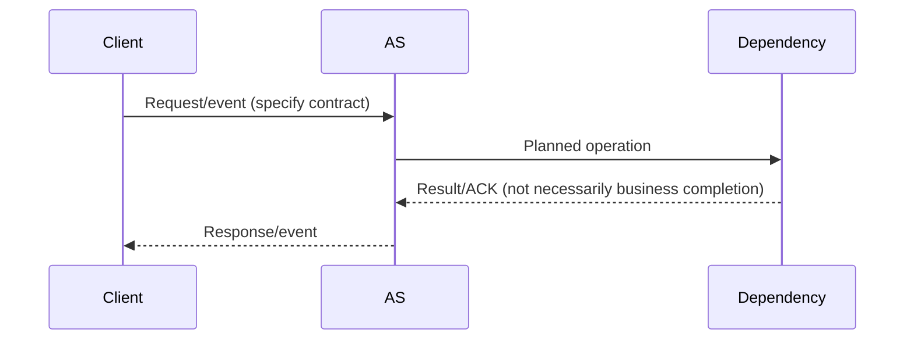

# [FTR-XXX] — [Feature title]

**Status:** PROPOSED / DISCOVERY / APPROVED / IMPLEMENTING / DEVELOPMENT-ACCEPTED / DEFERRED
**Created / updated:** YYYY-MM-DD
**Repository / branch / starting HEAD:**
**Product owner / reviewer:** UNKNOWN until named
**Related issue / requirement:**
**Implementation approval:** PENDING (separate from approving this assessment)

## 1. Problem and business value

Describe the real user or external system, present pain point, requested observable outcome, and why the feature is needed. Distinguish product requirements from architectural assumptions.

### Scope / non-goals

**In scope:**
**Out of scope:**  
**Known dependencies / constraints:**

### Acceptance criteria

| ID | Observable scenario | Expected result | Evidence/test |
|---|---|---|---|
| AC-01 | Given … when … | Then … | PENDING |

## 2. As-is system behavior (source-grounded)

Describe existing flow before changes. Include actual source references, versions and relevant test coverage. Do not extrapolate from legacy documents. Use labels: **SOURCE-CONFIRMED**, **TEST-OBSERVED**, **HISTORICAL**, **UNKNOWN**, **PROPOSAL**.

| Entry point / contract | Current behavior | Source/test path | Evidence class |
|---|---|---|---|
| HTTP / Socket / CDC / programmatic |  |  | UNKNOWN |

## 3. Responsibility and component impact matrix

Separate the component that currently *implements* a behavior from the owner who should *own* the business responsibility. Preserve M12/M13 `TBD` and M14/M15 `APP` unless a separately approved decision reclassifies them.

| Module (M01–M18) | Current responsibility | Feature-specific role | Proposed change | Business owner (APP/TBD/UNKNOWN) | Dependency impact |
|---|---|---|---|---|---|
|  |  |  |  |  |  |

**Unchanged modules with important compatibility dependencies:**  
**New responsibilities, if any (not classes/interfaces yet):**  
**Explicitly deferred ownership questions:**

## 4. Interaction flow and contracts

Actors/participants:  
Authentication/authorization:  
Trigger and entrypoint:  
Validation and error mapping:  
Outbound recipients / downstream dependencies:  
ACK/receipt/business completion semantics:  
Timeouts, retries, idempotency and ambiguity policy:

**Exact public contract impact** (paths, payload schema, event names, status/errors, versions):

| Contract | Before | After (proposal) | Compatibility action | Known consumers |
|---|---|---|---|---|
|  |  |  |  | UNKNOWN |

## 5. State, persistence and lifecycle

- **Owned state and mutation authority:**
- **Storage:** SQLite table / files / memory / remote; location and retention:
- **Atomicity and consistency boundary:**
- **Failure modes:** partial write, lost ACK, disconnect, duplicate, timeout, process kill, corrupt record:
- **Recovery / reconciliation / unknown delivery policy:**
- **Startup / shutdown / cleanup impact:**
- **Security and sensitive data:**
- **Metrics / logs / operational signals:**

Do not claim fsync/power-loss, external deduplication or exactly-once without independent evidence.

## 6. Compatibility and migration impact

| Concern | Changed? | Evidence / intended handling |
|---|---|---|
| CLI env flags and defaults | NO / YES / UNKNOWN | |
| Direct factory / lifecycle behavior | NO / YES / UNKNOWN | |
| HTTP API and Socket.IO events | NO / YES / UNKNOWN | |
| CDC/EServer/SPA/AA integration | NO / YES / UNKNOWN | |
| Public types/exports/legacy aliases | NO / YES / UNKNOWN | |
| Existing records/files/DB schema | NO / YES / UNKNOWN | |
| Release/versioning/migration/rollback | NO / YES / UNKNOWN | |

**Existing R7.5–R7.10 constraints explicitly considered:**  
**Unverified external callers:**

## 7. Bounded implementation plan (proposal only)

| Step | Files/modules | Allowed behavior | Acceptance evidence | Stop/rollback condition |
|---|---|---|---|---|
| 1 |  |  |  |  |

**Test plan:** unit, contract, focused integration, negative/failure cases, maintained manifest/serial/Full/playground where applicable.  
**Environment/fixture isolation:** use temp directories, disposable DB, loopback ports; no production peers/data.  
**Security / operations checks:**  
**Code review and human approval gate:**

## 8. Refactor memory (for future architecture work; not current authorization)

Capture what was learned during feature work:

- **Observed coupling or ownership ambiguity:**
- **Repeated patterns and why they exist:**
- **Possible future boundary to extract, with evidence required:**
- **What must remain compatible during any extraction:**
- **Why refactor was deferred now:**
- **Technical debt created, preserved or reduced (IDs):**

## 9. Implementation & verification record (fill after work)

**Implementation commit(s):**  
**Changed paths:**  
**Decisions adopted / rejected:**  
**Focused tests and observed results:**  
**Full/serial/playground checks and environment:**  
**Manual dev acceptance:**  
**Known residual risks:**  
**Final reviewer disposition:**  
**Links to reports/ADRs:**

**Rule:** No self-approval, no silent public contract migration, no unapproved refactor or production-readiness claim.
