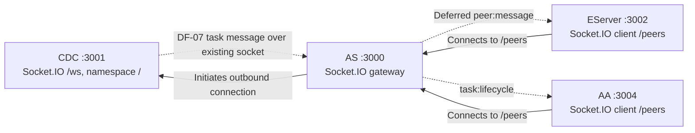
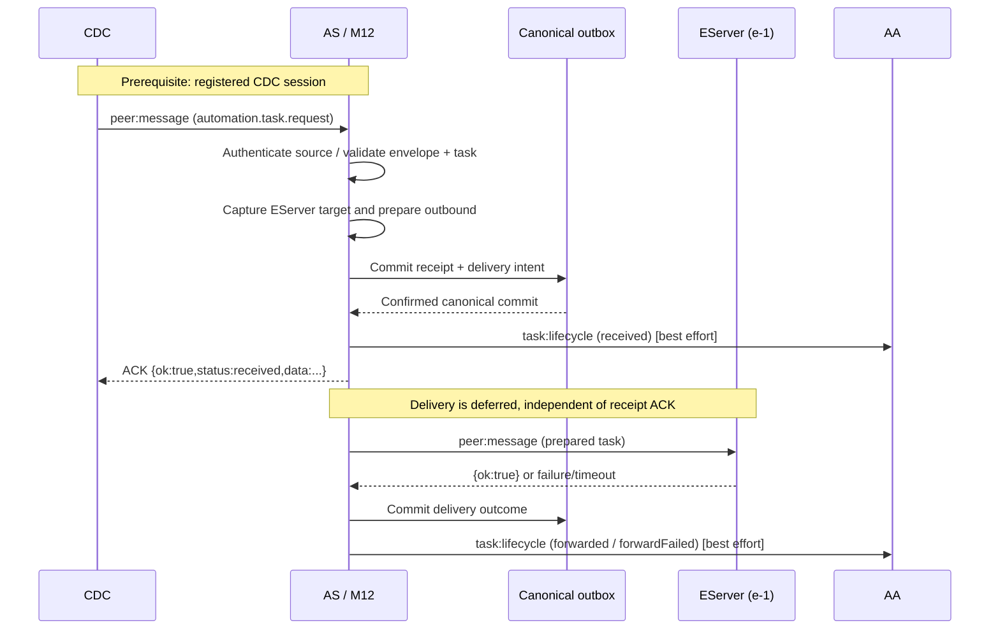

# DF-07 — CDC Task Request → AS → EServer

**Document type:** Developer Integration Guide / Business Flow Contract  
**Status:** Implemented in the feature-gated development baseline; not production integration certified  
**Repository:** `vutuantrung/base-aa-backend`  
**Source baseline:** `main` @ `72b31e54e266743fbfd18b6169e4a85c843ddeb7` (R7.10 closure)  
**Flow reference:** `docs/architecture/DATA_FLOW_INVENTORY.md` §2.5 (DF-07), also known as F08 in workflow reports  
**Scope:** Request and receipt only. A separate flow, **DF-08/F09**, handles EServer's eventual `finished` result.

> The examples below document the protocol implemented at the specified commit. The ports and test endpoints are **local playground examples**, not a production topology. `received` means AS committed its canonical receipt and delivery intent; it **does not** mean EServer received or executed the task.

> **Naming/current-source note:** The source SHA above is retained as historical provenance. This maintained guide uses the NM.2.2 local contracts and paths; current source links are listed in §9. It is not evidence of a deployed or manually launched integration.

## 1. Purpose and responsibilities

CDC submits a task destined for a particular EServer instance (or the single unambiguous available instance). AS validates the peer envelope and task, commits a receipt + outbound delivery intent to its workflow store, acknowledges acceptance to CDC, then independently forwards the prepared message to EServer. AA observes the live lifecycle updates but does not execute the task.

| Actor | Responsibility |
|---|---|
| CDC | Hosts the Socket.IO endpoint for AS, performs session registration ACK, submits `automation.task.request`, handles receipt ACK |
| AS / M03–M04 | Opens outbound Socket.IO connection to CDC; manages session registration/readiness |
| AS / M05–M06 | Peer ingress and authenticated identities; EServer connections / physical availability |
| AS / M12 | Validates task, captures destination, persists receipt + outbox intent, publishes lifecycle, schedules delivery |
| AS / M10–M11 | Prepared peer message routing, optional transformation and destination ACK handling |
| EServer | Connects to AS `/peers`, receives `peer:message`, responds with protocol ACK; execution/result is outside DF-07 |
| AA | Optional observer of `task:lifecycle` events and task snapshot |

## 2. Connection topology



**Physical connection direction differs from message direction:** CDC does **not** connect to AS `/peers`. AS connects to CDC; then CDC can emit `peer:message` to AS on that established connection. EServer connects to AS `/peers` using `auth.peerId: "eserver"` and an optional `auth.instanceId` (defaults to `default` when omitted).

### 2.1 Start the local playground

From repository root, using Node.js 22.23.5 (verified baseline):

```bash
npm install
npm install --prefix testing

# Terminal 1 — CDC
npm --prefix testing run cdc

# Terminal 2 — AS (Linux/macOS syntax)
ENABLE_TEST_PEERS=1 npm run dev

# Terminal 3 — EServer with explicit identity
ESERVER_INSTANCE_ID=e-1 ESERVER_PORT=3002 npm --prefix testing run eserver

# Terminal 4 — SPA
npm --prefix testing run spa

# Terminal 5 — AA, optional for notifications
npm --prefix testing run aa
```

PowerShell example for AS:

```powershell
$env:ENABLE_TEST_PEERS = '1'
npm run dev
```

- `ENABLE_TEST_PEERS=1` is required by the **CLI** for the peer gateway and CDC connector. It is recognized only when the value is exactly `'1'`.
- AS defaults to port `3000`; CDC defaults to `http://127.0.0.1:3001`; EServer playground defaults to port `3002`. Change these according to your environment.
- Optional AS configuration: `CDC_URL`, `CDC_SOCKET_PATH` (default `/ws`), `VM_UDID`, `VM_SDK`, `VM_MODEL`, `VM_ABI`, `VM_FOR_SEARCH`, `VM_PLATFORMS`, `API_KEY`, `AS_TASK_STORE_DIR` (default `./data/tasks`), and `AS_SELECTION_STORE_DIR` (default `./data/resource-selections`). The peer clients accept `AS_URL` (default `http://127.0.0.1:3000`).
- The `.env` file is a reference and is **not automatically loaded** by the current CLI. Export variables in the shell or use a supported env-file launch procedure.
- The peer gateway, task store and outbox for this flow are independent of `ENABLE_SQLITE`; F08 is **not stored in the SQLite catalog**.
- Keep playground endpoints on loopback; use credentials and a secured network in shared development environments.

### 2.2 CDC transport and session registration (prerequisite)

AS's Socket.IO client connects to CDC using:

| Property | Value |
|---|---|
| URL | `CDC_URL` (`http://127.0.0.1:3001` in playground) |
| Engine.IO `path` | `CDC_SOCKET_PATH` (default `/ws`) |
| Namespace | `/` (default) |
| Transport choices | WebSocket then polling |
| Auth | `{ "peerId": "as", "token": "..." }` when `API_KEY` configured |
| Registration event | `automation_vm:session:connect` |
| Registration ACK timeout | 10 seconds |

Initial registration payload (example):

```json
{
  "udid": "vm-001",
  "sdk": "33",
  "model": "Pixel",
  "abi": "arm64-v8a",
  "forSearch": false,
  "platforms": ["facebook", "youtube"]
}
```

Expected CDC registration ACK:

```json
{
  "ok": true,
  "session": {
    "id": "session-001",
    "vm_udid": "vm-001"
  }
}
```

AS marks the CDC transport *session-ready* only after receiving an ACK containing `ok:true` and a nonempty session ID. On socket reconnection it submits `{ "session_id": "session-001" }` instead of VM details. This ID lives in AS process memory, not a durable store. CDC task requests sent before session readiness are rejected (when using the ACK-bearing protocol) with `UNSUPPORTED_DESTINATION` / `CDC session not ready`.

### 2.3 EServer connection to AS

Install `socket.io-client` in the EServer application. Example:

```js
import { io } from 'socket.io-client';

const socket = io('http://127.0.0.1:3000/peers', {
  auth: {
    peerId: 'eserver',
    instanceId: 'e-1',
    // token: process.env.API_KEY, // required when AS has API_KEY
  },
});

socket.on('connect', () => console.log('Connected:', socket.id));
socket.on('connect_error', (error) => console.error('Connection rejected:', error.message));
socket.on('as:welcome', (message) => console.log('Welcome:', message));

socket.on('peer:message', (message, acknowledge) => {
  if (message?.payload?.type !== 'automation.task.request') return;
  console.log('Task received:', message.payload.data);
  // ACK only after satisfying your receiver-side acceptance policy.
  // Do NOT claim execution has completed merely because this ACK was sent.
  acknowledge?.({ ok: true });
});
```

- `eserver` allows multiple instances distinguished by `instanceId`; duplicate connected identities are rejected.
- An EServer **must ACK `peer:message`** for AS to consider the outbound peer delivery acknowledged. AS's peer delivery ACK timeout is 5 seconds.
- The sample demonstrates receiving the task, **not** implementing an executor or business result.
- A separate implementation must handle `DF-08` to report `status: "finished"` to CDC.

## 3. DF-07 protocol and sequence



The ordering of the **received notification and CDC ACK callback** may be observed differently by different remote clients; rely on the ACK contract, not arrival order at AA. Internal code projects the received notification before returning the receipt result from M12.

## 4. Message contracts

### 4.1 CDC → AS: `peer:message`

Use event name exactly **`peer:message`**, not `activity:task:dispatch` and not the Generic Messaging `message` event.

Example payload:

```json
{
  "id": "d525e18f-5fd7-497c-a99f-e3d16bd6cc7a",
  "version": "1.0",
  "kind": "request",
  "from": "cdc",
  "to": "eserver",
  "toInstanceId": "e-1",
  "channel": "worker",
  "event": "message",
  "correlationId": "task-demo-001",
  "payload": {
    "type": "automation.task.request",
    "version": "1.0",
    "data": {
      "id": "task-demo-001",
      "status": "inProgress",
      "config": "automation-config-json-or-string",
      "createdTime": 1794500000000,
      "updatedTime": 1794500000000
    }
  }
}
```

Envelope rules (from `incomingPeerMessageSchema`):

| Field | Required | Validation/meaning |
|---|---|---|
| `id` | No | Valid UUID; if absent, AS generates one. **Task dedupe uses `payload.data.id`**, not this message ID |
| `version` | No | Literal `"1.0"`; defaults to `"1.0"` |
| `kind` | **Yes** | `request`, `response`, or `event` (DF-07 does not impose a narrower `kind` check) |
| `from` | **Yes** | Must equal `"cdc"` and match authenticated transport source |
| `to` | **Yes** | Must equal `"eserver"` |
| `toInstanceId` | No | Trimmed nonempty string, max 100 chars; identifies EServer; belongs in **envelope**, not task data |
| `channel` | No | String, 1–100 chars; default `"worker"` |
| `event` | No | Literal `"message"`; defaults to it |
| `correlationId`, `causationId` | No | Nonempty strings, max 200 characters |
| `payload.type` | **Yes** | Exact literal `"automation.task.request"` for this flow |
| `payload.version` | No | Trimmed string, 1–30 chars; default `"1.0"` |
| `payload.data` | **Yes** | Strict task data contract below |

The inbound envelope and `payload` object reject unexpected fields. AS adds an outbound `timestamp` (Unix milliseconds), generated `id` if needed, and optional processing metadata.

### 4.2 Strict task data (`payload.data`)

| Field | Type / rules | Required |
|---|---|---|
| `id` | String matching `^task-[a-zA-Z0-9-]{1,100}$` | Yes |
| `status` | Exactly `"inProgress"` for DF-07 | Yes |
| `config` | String (could contain serialized configuration; this flow does not parse it) | Yes |
| `createdTime` | Nonnegative integer | Yes |
| `updatedTime` | Nonnegative integer | Yes |

Do not place `toInstanceId`, arbitrary extension fields or status `finished` inside the request task data. The task schema is strict. The F08 workflow does not introduce additional timestamp ordering validation beyond this schema; do not assume the sample timestamp values establish a unit for all upstream sources.

### 4.3 AS → CDC: receipt ACK

Success example (the `data` object is a **normalized task peer envelope**, not only the task body):

```json
{
  "ok": true,
  "status": "received",
  "data": {
    "id": "d525e18f-5fd7-497c-a99f-e3d16bd6cc7a",
    "version": "1.0",
    "kind": "request",
    "from": "cdc",
    "to": "eserver",
    "toInstanceId": "e-1",
    "channel": "worker",
    "event": "message",
    "correlationId": "task-demo-001",
    "payload": {
      "type": "automation.task.request",
      "version": "1.0",
      "data": {
        "id": "task-demo-001",
        "status": "inProgress",
        "config": "automation-config-json-or-string",
        "createdTime": 1794500000000,
        "updatedTime": 1794500000000
      }
    },
    "timestamp": 1794500000100
  }
}
```

**Receipt semantics:** a canonical record holding the receipt and initial outbound intent was confirmed under the R7.5 file-persistence protocol. The ACK is **not** proof of EServer connection, network receipt, execution, completion, or exactly-once effects. Even if preparation fails or the target is ambiguous, AS can commit a receipt and record terminal `failed` delivery intent, producing a later `forwardFailed` notification.

### 4.4 AS → EServer: deferred delivery

AS delivers the prepared message over event **`peer:message`** to the chosen EServer instance. It preserves the business task data and adds outbound metadata such as `timestamp`, `id`, and `processing` (the latter depends on transformation processing). AS waits up to 5 seconds for the recipient ACK:

```json
{ "ok": true }
```

A successful receiver ACK means accepted **at the peer protocol boundary**. An example of negative receiver ACK:

```json
{ "ok": false, "error": "Cannot accept task" }
```

The receiver should not send a `finished` task result as part of DF-07 unless a separate DF-08 workflow is intentionally implemented.

### 4.5 Error ACKs returned to CDC

| Situation | Example ACK | Notes |
|---|---|---|
| Invalid peer/task envelope | `{ "ok": false, "code": "INVALID_MESSAGE", "error": "Invalid CDC task envelope" }` | Task-schema validation uses `"Invalid inProgress task payload"` |
| Conflicting duplicate `task.id` | `{ "ok": false, "code": "INVALID_MESSAGE", "error": "Conflicting duplicate task operation" }` | Same operation key but different task/target fingerprint |
| Outbox persist/capacity failure | `{ "ok": false, "code": "DELIVERY_FAILED", "error": "Could not persist task at AS" }` | Capacity may report `"Reliability queue capacity is full"` |
| CDC session not ready | `{ "ok": false, "code": "UNSUPPORTED_DESTINATION", "error": "CDC session not ready" }` | Sent by CDC protocol boundary before workflow |
| Application draining | `{ "ok": false, "code": "DELIVERY_FAILED", "error": "APPLICATION_DRAINING" }` | New admitted peer operation blocked during shutdown |
| EServer offline / rejection after commit | **CDC may already have received `status:received`** | Later delivery state/AA notification captures outcome; not an immediate receipt rejection |

ACK timeouts or connection loss should be treated as **unknown receipt outcome** by the sender. Repeating a request with the same `task.id` and identical normalized task + captured target can return the stored receipt; changing the payload or target can conflict. Do not generate a new task ID blindly to “retry” a possibly accepted business task.

## 5. Target selection, dedupe and reliability

### 5.1 Selecting EServer

- **Explicit**: `toInstanceId: "e-1"` targets that identity.
- **Implicit**: when exactly one EServer identity is registered, AS uses its `instanceId`.
- **Ambiguous/unavailable**: zero or multiple registered EServers without explicit target can yield a committed receipt with a terminal failed-delivery outcome. It does not silently pick an arbitrary instance.
- Target identity is captured for the initial operation. It is not reselected later simply because connection membership changes.

### 5.2 Duplicate request policy

R7.5 canonical dedupe key: `F08:<task.id>`. Fingerprint contains the validated task and effective captured destination. Exact duplicates return the original persisted ACK. Different content or target for the same task ID returns `INVALID_MESSAGE` conflict. An omitted target on a duplicate uses the originally captured target for comparison.

### 5.3 Outbox state and retry safety

Canonical states include `queued`, `attempting`, `retryable`, `delivered`, `failed`, `uncertain`. On eligible proven-unsent failures (e.g. destination not ready before emission), the bounded runner may retry; send attempts with uncertain outcome are **not automatically replayed**. The R7.5 policy defaults to initial + 5 retries, with delayed backoff, age and capacity limits. Records are stored under `AS_TASK_STORE_DIR/.r7.5-outbox`; legacy `task-*.json` projections exist for compatibility and history.

Not guaranteed: receiver-side durable persistence, exactly-once execution, recovery from every power-loss scenario, safe replay of a timed-out remote delivery, or a durable replayable AA event log.

## 6. AA observer events (optional)

AA connects to `http://127.0.0.1:3000/peers` with `auth: { peerId: 'aa', token?: '...' }` and listens to:

| Event | Example meaning |
|---|---|
| `task:lifecycle` | `{ task, status:'received'|'forwarded'|'forwardFailed', instanceId, event:'task.received'|..., timestamp, reason? }` |
| `task:lifecycle:snapshot` | `{ timestamp, tasks: [{ task, status:'received'|'finished', event:'task.snapshot' }] }` (up to 50) |
| `task:lifecycle:refresh` | AA → AS request to send a fresh snapshot |

Example live event:

```json
{
  "task": {
    "id": "task-demo-001",
    "status": "inProgress",
    "config": "automation-config-json-or-string",
    "createdTime": 1794500000000,
    "updatedTime": 1794500000000
  },
  "status": "forwarded",
  "instanceId": "e-1",
  "event": "task.forwarded",
  "timestamp": 1794500001500
}
```

Live events are best effort. The snapshot is a limited history projection; it is not a complete outbox audit log.

## 7. Test DF-07 end to end in the playground

Once CDC, AS, EServer `e-1` and optionally AA are running, submit a request using CDC's **playground-only** HTTP endpoint:

```bash
curl -i -X POST 'http://127.0.0.1:3001/demo/tasks?toInstanceId=e-1' \
  -H 'Content-Type: application/json' \
  -d '{
    "id": "task-demo-001",
    "status": "inProgress",
    "config": "example automation config",
    "createdTime": 1794500000000,
    "updatedTime": 1794500000000
  }'
```

The playground CDC constructs and emits the actual `peer:message` over its registered Socket.IO connection to AS. This is **not** an AS `/api/messages` HTTP call. CDC may return HTTP `202` when the receipt ACK is accepted; inspect its response body for actual results.

Expected observations:

1. CDC has an established AS transport and registered session.
2. CDC sends `automation.task.request` with `from:cdc`, `to:eserver`, target `e-1`.
3. AS commits a canonical task receipt/outbox record before successful `received` ACK.
4. AA (if connected) observes `task:lifecycle` with `received`.
5. EServer `e-1` receives the forwarded `peer:message` and returns protocol ACK.
6. AA subsequently observes `forwarded` (or `forwardFailed` with reason); an EServer ACK does **not** imply a finished task.
7. If a result is required, exercise **DF-08/F09** separately.

> For repeat testing, change `task.id` to a **new unique task ID** for a new business task, or deliberately reuse the exact same ID/payload/target to verify duplicate receipt behavior. Old canonical records persist between process restarts.

## 8. Troubleshooting

| Symptom | Check |
|---|---|
| No AS → CDC connection | CDC process/URL/`CDC_SOCKET_PATH`; AS feature mode; network; Socket.IO auth |
| Session registration never ready | Confirm `automation_vm:session:connect` ACK has `ok:true` and `session.id`; 10 s timeout |
| EServer connection rejected | `/peers` namespace; `auth.peerId='eserver'`; `auth.instanceId` conflict; API key; draining |
| `INVALID_MESSAGE` | Use `peer:message`, correct `from` and `to`, strict payload type/task shape, valid UUID if supplied |
| `received` but no EServer message | Check captured `toInstanceId`, destination readiness, queue/terminal state, EServer auth and logs |
| `forwardFailed` | Check lifecycle reason and canonical outbox evidence; do not assume receipt was rolled back |
| Peer delivery timed out | Receiver must call ACK within 5 s; timeout may mean **uncertain** delivery, never blind auto-retry |
| No AA notification | AA connected? `auth.peerId='aa'`? Notifications are not durable subscriptions |
| Repeated task appears unchanged | Canonical deduplication by task ID; inspect stored receipt and whether caller submitted the exact same operation |
| Task queue rejects requests | Check capacity, permissions, filesystem hard-link capability, writer lock and quarantine; do not remove locks blindly |

## 9. Source references and change-control

| Concern | Source |
|---|---|
| DF-07 registry | `docs/architecture/DATA_FLOW_INVENTORY.md` §2.5 |
| Peer envelope / ACK schema | `src/modules/peer-messaging/contracts.ts` |
| F08 validation, target, receipt, projection | `src/modules/task-workflow/task-workflow.ts` |
| Strict task schema / storage path | `src/modules/task-workflow/task-file-store.ts` |
| Peer gateway, dispatch, AA events | `src/infrastructure/socket/peer-gateway.ts` |
| EServer handshake | `src/infrastructure/socket/socket-peer-gateway.ts` |
| CDC session / ingress | `src/modules/cdc/cdc-protocol.ts`, `src/infrastructure/socket/cdc-transport.ts` |
| Delivery behavior | `src/modules/peer-messaging/peer-message-service.ts`, `src/infrastructure/socket/socket-peer-message-delivery.ts` |
| Approved retry/durability policy | `docs/architecture/R7_5_RELIABILITY_POLICY.md` |
| Local test procedure | `testing/README.md`, `testing/cdc.mjs`, `testing/eserver.mjs` |

**Compatibility rule:** Do not change `automation.task.request`, peer envelope, CDC registration, F08 receipt meaning, canonical dedupe key, EServer target selection or ACK semantics without an explicitly reviewed contract change. Record new behaviors and acceptance evidence in this living document when DF-07 evolves.
