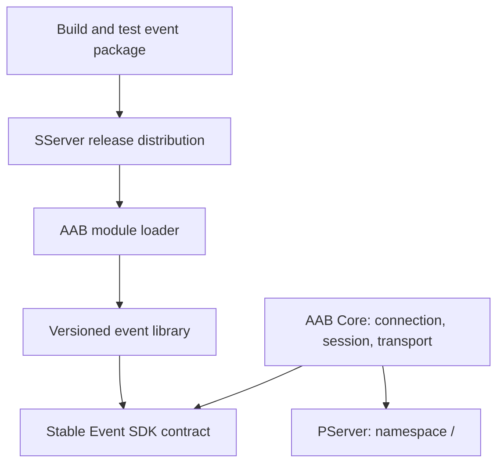

# AAB — Dynamic Event Library: Architecture Discussion & Handoff

> **Historical/mixed document:** The discussion and accepted historical status below retain original terminology and proposals. For current implementation references, use `AS`, `CDC`, `SPA`, `AA` and the current source paths in the final implementation-reference section. No dynamic event library is implemented or authorized by this naming update.

**Status:** Deferred / discussion only. No implementation approved.

**Repository:** https://github.com/vutuantrung/base-aa-backend  
**Branch:** `feature/pserver-connector-only`  
**Last verified branch checkpoint:** `5ebdc89aacb1e9a0776cfffc28cad67f7fbb7c51` (from earlier conversation; recheck before resuming).  
**Main at isolation checkpoint:** `82b6cb68e2016594d42731c2ae022ce43b638557`.

## 1. Context and scope

AAB is a Node.js/TypeScript Socket.IO client connecting to PServer. PServer extends its protocol through additional events, not additional namespaces. Keep the default namespace `/`, Engine.IO path `/ws`, one connection and existing application session registration. The isolated branch contains AAB, mock PServer, session tests and documentation; unrelated peers and routing/storage subsystems were removed from this branch only.

SServer is envisioned as an application update manager, with AAB as one managed application. Since business event handling is expected to change more frequently than connection infrastructure, the user raised the possibility of independently compiling, packaging, versioning and loading the event section. This is a discussion, not a decision to implement a plugin framework. Resume the ordinary event-handler design first; the dynamic library discussion is deferred.

## 2. Proposed architecture



Three independently versioned components were proposed:

| Component | Responsibility | Change frequency |
|---|---|---|
| AAB Core | Bootstrap, socket, session, reconnect, transport, loader, activation | Low |
| Event SDK | Stable context, transport, session reader and module contracts | Low |
| PServer Event Library | Business event names, payload validation, handlers, services and response mapping | High |

Library depends on SDK, not Core implementation. Core must not statically import the independently released implementation. Connection and session ownership remain with Core. Do not pass raw socket or application instance to library. SDK interfaces are architectural boundaries, not security sandboxing.

## 3. Packaging and versioning proposals

Compile TypeScript to ESM JavaScript. `tsc` emits JS/declarations but does not bundle dependencies. A bundler such as esbuild can produce a self-contained artifact for supported runtime dependencies; native/external dependencies need separate handling. Candidate packaging: ESM bundle + manifest + ZIP (or npm tarball). CI builds/tests/publishes; SServer distributes releases. AAB should not compile on deployment.

Example manifest (illustrative, not an agreed schema):

```json
{
  "manifestVersion": 1,
  "name": "aab-pserver-events",
  "version": "1.2.0",
  "entry": "./dist/index.js",
  "compatibility": {
    "eventSdk": "^1.0.0",
    "aabCore": ">=1.0.0 <2.0.0",
    "node": ">=22"
  },
  "capabilities": ["activity-task", "messaging"]
}
```

Use immutable per-version directories; never overwrite a published version. Release metadata should include checksum and authenticated signature/trusted release identity. Verify before import; constrain extraction paths, entry path and artifact origin. A checksum alone does not authenticate the publisher.

```text
data/libraries/aab-pserver-events/
  active.json
  1.0.0/manifest.json
  1.0.0/dist/index.js
  1.1.0/manifest.json
  1.1.0/dist/index.js
```

`active.json` may identify active and previous versions. Persist selection atomically after successful activation; distinguish staged, desired and active version. Support rollback to last known good artifact. Rolling back code does not undo business side effects or data migrations.

## 4. SDK and module interface (illustrative)

```typescript
export interface SessionReader {
  isReady(): boolean;
  getSessionId(): string | undefined;
  getVmUdid(): string;
}

export interface EventTransport {
  emit(event: string, payload: unknown): void;
  emitWithAck(event: string, payload: unknown, timeoutMs?: number): Promise<unknown>;
}

export interface EventDefinition {
  name: string;
  handle(payload: unknown): unknown | Promise<unknown>;
}

export interface EventModuleContext {
  transport: EventTransport;
  session: SessionReader;
  logger: Logger;
}

export interface EventModule {
  name: string;
  version: string;
  getEvents(): readonly EventDefinition[];
  dispose(): Promise<void>;
}
```

`Logger` is a placeholder contract. Library exports `createEventModule(context)`. This sketch does not yet define ACK semantics, event direction, initialization failure, cancellation, readiness or in-flight ownership. Do not treat it as a production SDK. Consider runtime validation of exports/manifest; TypeScript types do not validate external code at runtime.

Load a verified entry via `await import(pathToFileURL(entryPath).href)`. Each immutable version directory has a distinct module URL. ESM import caches modules; `dispose()` does not unload them from Node.js memory. Avoid claiming that dynamic import alone implements hot reload.

## 5. Update protocol proposal

SServer owns desired version, rollout policy and release distribution. AAB owns compatibility checks, staging and activation. Do not automatically choose latest solely from SemVer; desired version may intentionally be older for rollback.

1. CI builds and tests artifact, publishes immutable release.
2. SServer communicates application ID, component ID, desired version, artifact URL, checksum and authenticated release metadata.
3. AAB compares desired with active version.
4. Download, verify provenance/integrity, validate manifest/compatibility.
5. Stage version in separate directory.
6. Import and validate candidate exports; initialize safely.
7. Activate and persist version pointer, retain last known good.
8. Report actual active version, success/failure and diagnostics to SServer.

No SServer API, transport or release protocol has been agreed. SServer implementation is out of current branch scope.

## 6. Activation levels

| Level | Mechanism | Tradeoff |
|---|---|---|
| 1 | Install version, restart AAB, import on startup | Simplest; connection briefly interrupted; no Core rebuild |
| 2 | In-process dynamic import and handler swap | Preserve socket; lifecycle/in-flight/cache complexity |
| 3 | Worker or child process per module generation | Replace runtime and reclaim resources more reliably; IPC overhead |

Proposal: implement Level 1 first if this project is resumed; Level 2 only when no-disconnect updates are required. Worker threads are not a strong security sandbox; use restricted process/container for stronger isolation.

For hot swap, Core owns listeners and retains a dispatcher pointing at an active handler map. Register new event names, remove only owned listener references for removed names, and atomically switch handler generation. Never remove all listeners. Existing operations retain their generation until complete. Two versions may coexist only when shared state and side effects are compatible; otherwise quiesce/drain before switch. Set a bounded drain policy and handle failures. Reconnect must not register duplicate listeners. No hot swap has been implemented.

## 7. Proposed ADRs — all unapproved

| ID | Proposal |
|---|---|
| ADR-D01 | Independently build and version event library |
| ADR-D02 | Depend on stable Event SDK, not Core implementation |
| ADR-D03 | SServer owns desired version; AAB owns activation |
| ADR-D04 | Immutable artifacts per version |
| ADR-D05 | Core owns socket and session |
| ADR-D06 | Core owns event registration and dispatcher when hot swap is needed |
| ADR-D07 | Last-known-good rollback from first release |
| ADR-D08 | Startup dynamic loading first; hot reload later |
| ADR-D09 | Verify artifact origin, integrity and compatibility before import |
| ADR-D10 | Explicit module lifecycle/disposal |

Open questions: packaging, precise SDK, PServer protocol compatibility independent of SDK compatibility, update failure/crash recovery, event ACKs, state migrations, concurrency, trust model, whether hot reload is genuinely necessary, and repository organization. Earlier proposal used one repository with `apps/aab`, `packages/event-sdk`, `packages/pserver-events`; no workspace migration approved.

## 8. Deferred roadmap

- D1 — Event boundary extraction.
- D2 — Event SDK and module contract.
- D3 — Standalone compiled/versioned library.
- D4 — Dynamic module loader.
- D5 — Compatibility/version management and rollback.
- D6 — SServer update protocol.
- D7 — Hot reload and dispatcher.
- D8 — Runtime reliability/security/drain/memory management.

## 9. Return to current work: static event-handler design

The active roadmap is E1–E6, not D1–D8. No multi-namespace manager, loader, dynamic import, package extraction, event registry, or SServer updater is needed right now. Start with connection/session separation and explicit handler registration; extract business handlers by business boundary, not one module per event. Keep current protocol events `automation_vm:session:connect`, `activity:task:dispatch`, and diagnostic `peer:message`. Preserve session registration/resume, ACK timeouts (10s registration, 5s outbound diagnostic), readiness and task validation. Do not introduce unconfirmed PServer events.

Current source equivalents: `src/main.ts`, `src/app/create-app.ts`, `src/infrastructure/socket/cdc-connector.ts`, `testing/cdc.mjs`, `tests/cdc-session.test.ts`, `tests/support/mock-cdc.ts`, `docs/CDC_SESSION_PROTOCOL.md`, `AGENTS.md`. The historical discussion above deliberately retains the original branch and architecture terms.

Coding rules: intent-revealing names, small functions, avoid unnecessary type assertions, prefer inference and runtime narrowing; no speculative abstractions. Register handlers once before connection, avoid duplication on reconnect. Distinguish session registration (socket connected only) from business events (session ready). Preserve actual inbound ACK behavior per event.

E1 connection/session separation; E2 event transport abstraction if justified; E3 event handler extraction; E4 payload/ACK contracts and runtime validation; E5 event expansion after PServer contract confirmed; E6 reliability/regression tests throughout. Earlier E-series ADRs were proposed, not confirmed. No code changes authorized by this handoff.

## 10. Resume prompt

> Read this handoff. We are resuming the deferred Dynamic Event Library discussion for `vutuantrung/base-aa-backend`, branch `feature/pserver-connector-only`. Recheck branch HEAD and the current static event architecture, distinguish decisions confirmed since this checkpoint from proposals, then review SDK/module contract and activation levels. Do not modify code until I explicitly approve implementation. Respect AGENTS.md and avoid unnecessary type assertions.
